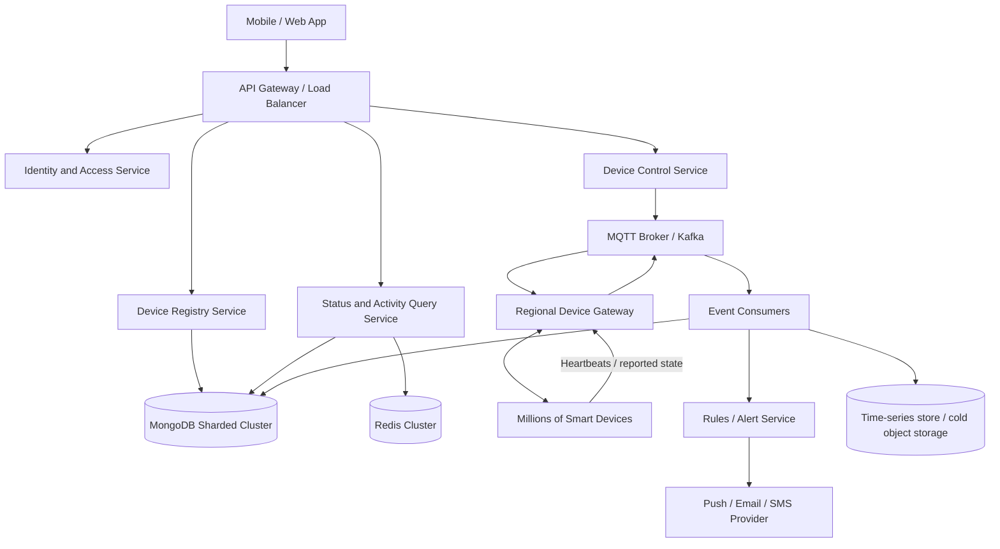

# Round 3 — High-Level System Design

## 1. Goals and assumptions
Support millions of registered devices, frequent heartbeats/status changes, interactive control, activity history, alerts, and notifications. Device commands should be asynchronous and observable; a command accepted by the server is not considered successful until the device acknowledges it.

## 2. Architecture

### Main components
1. **API Gateway** — TLS termination, routing, rate limiting, request tracing.
2. **Identity and Access** — user login, access tokens, household/device ownership and role checks.
3. **Device Registry** — registration, metadata, room assignment and lifecycle.
4. **Device Control** — validates commands and publishes command events to a broker.
5. **Device Gateway** — maintains secure device connections and translates protocol-specific messages.
6. **Status/Activity Query** — serves current state and paginated event history.
7. **Event Consumers** — persist telemetry, update status projections and trigger rules.
8. **Alert/Notification** — detects offline devices, abnormal readings and user-defined events.

## 3. Communication
- App to backend: HTTPS REST/JSON for registration, queries and user actions.
- Device to gateway: MQTT over TLS for lightweight publish/subscribe; HTTPS may be used for constrained integrations.
- Internal asynchronous events: Kafka for durable, partitioned event streams; MQTT broker for device delivery.
- Commands carry `commandId`, `deviceId`, `issuedAt`, `expiresAt`, `command`, and `correlationId`.
- Device acknowledgements carry `commandId`, result, reported state, and timestamp. Deduplicate by `commandId`.

## 4. Database choices
- **MongoDB** for user/device metadata and flexible device state. Shard by a stable hashed `deviceId` or tenant-aware key after measuring workload; index `{tenantId, deviceId}` and status/last-seen fields.
- **Redis** for hot current status and frequently read user/device summaries. Use TTL and event-driven invalidation; database/event stream remains the durable source.
- **Kafka** for ordered per-device event streams, buffering bursts, replay and decoupling producers from consumers. Partition on `deviceId` to preserve per-device order.
- **Time-series database/object storage** for high-volume sensor telemetry and long retention, separated from operational device metadata.

## 5. Caching strategy
- Cache current device status with a short TTL (for example 15–60 seconds, tuned to heartbeat frequency).
- On a status event, update/invalidate the cache. Use version/timestamp checks to prevent stale events overwriting newer values.
- Cache user device lists and device configuration only briefly; invalidate on create/update/delete.
- On cache miss, read from the database and repopulate. If cache is unavailable, fall back to the database with rate limits and circuit breakers.

## 6. Messaging and notifications
1. Control service validates ownership and online state.
2. It writes a command record/outbox entry and publishes a command event.
3. Gateway routes the event to the device connection.
4. Device returns acknowledgement and reported state.
5. Consumers update the status projection, activity history and cache.
6. Alert rules evaluate events and notify users through push/email/SMS.
7. Retry transient failures with exponential backoff; send poison messages to a dead-letter queue. Commands have expiry times and must not be replayed indefinitely.

## 7. Scaling to millions of devices
- Horizontally scale stateless API services behind a load balancer.
- Deploy regional device gateways and partition MQTT sessions/connections.
- Partition Kafka topics by device ID; scale consumer groups independently.
- Use MongoDB sharding and appropriate compound indexes; archive old activity/telemetry data.
- Batch telemetry writes and apply backpressure when event ingestion is overloaded.
- Use autoscaling based on request rate, queue lag, active connections and CPU/memory.
- Apply quotas and rate limits per account/device to prevent noisy-neighbour effects.

## 8. Reliability, security and observability
- TLS in transit, encryption at rest, per-device credentials/certificates and credential rotation.
- Authorization on every device operation; never trust a client-supplied device ID alone.
- Multi-zone deployment, health checks, retries with jitter, timeouts, circuit breakers and graceful degradation.
- At-least-once event delivery with idempotent consumers; do not assume exactly-once physical device actions.
- Monitor API latency/error rates, broker lag, command acknowledgement latency, device online percentage, cache hit rate and database saturation.
- Centralized structured logs, distributed traces, metrics and alerts; define recovery objectives and test backups.

## 9. Key trade-offs
- **REST + asynchronous messaging** keeps app requests responsive and isolates API availability from device connectivity, but requires command status tracking.
- **MongoDB + Redis** provides flexible metadata and fast reads, at the cost of cache invalidation and eventual consistency.
- **Kafka/event-driven processing** absorbs bursts and enables replay, but adds operational complexity and requires idempotent consumers.
- **Regional gateways** reduce latency and improve fault isolation, but require device routing and regional failover planning.
