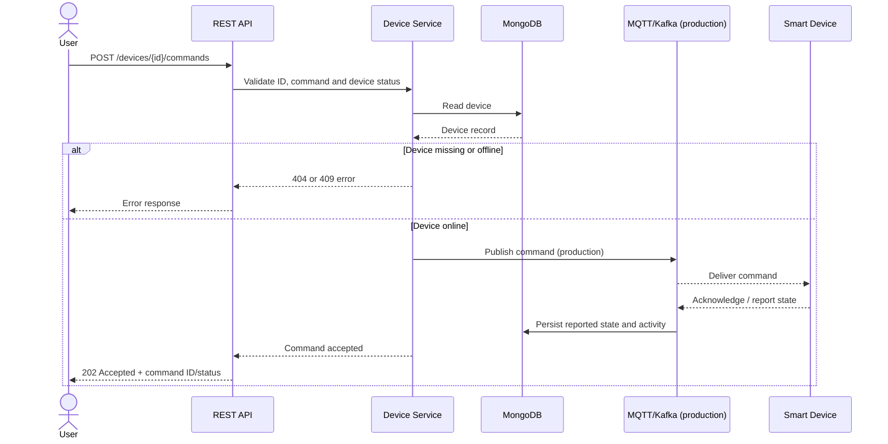

# Round 2 — Low-Level Design

## 1. API design
All APIs use JSON. Base path: `/api/v1/devices`.

| Operation | HTTP method | URI | Request body | Response |
|---|---|---|---|---|
| Register device | POST | `/api/v1/devices` | `{"name":"Hall Light","type":"light","room":"Hall"}` | `201` + created device |
| Get device status | GET | `/api/v1/devices/{id}/status` | None | `200` + status/state/lastSeen |
| Control device | POST | `/api/v1/devices/{id}/commands` | `{"command":"turn_on"}` | `202` + accepted command |
| Get activity | GET | `/api/v1/devices/{id}/activity?limit=50` | None | `200` + newest-first activity array |
| Remove device | DELETE | `/api/v1/devices/{id}` | None | `200` + removal confirmation |
| Device heartbeat/status | PATCH | `/api/v1/devices/{id}/status` | `{"status":"online","state":{"power":"on"}}` | `200` + updated device |

## 2. HTTP status codes
- `200 OK`: status/activity retrieval, successful update or removal.
- `201 Created`: device registration succeeded.
- `202 Accepted`: command accepted for asynchronous delivery; not a guarantee that the physical device has already acted.
- `400 Bad Request`: missing required values, invalid ID, status or command.
- `404 Not Found`: device or route does not exist.
- `409 Conflict`: command cannot be accepted because the device is offline.
- `500 Internal Server Error`: unexpected server failure.

## 3. Data model
**Device**: `_id`, `name`, `type`, `room`, `status`, `state`, `lastSeen`, `createdAt`.

**Activity**: `_id`, `deviceId`, `action`, `details`, `createdAt`.

Indexes: Device `{status, lastSeen}` for status monitoring; Activity `{deviceId, createdAt}` for per-device timeline and recent events.

## 4. Control request sequence


## 5. Error response format
```json
{
  "error": "Device is offline; command was not sent"
}
```

## 6. Validation and reliability
- Validate required fields and supported enum values.
- Validate MongoDB object IDs before querying.
- Cap activity history results to 200 per request.
- Use JSON request size limit and centralized error handling.
- In production, add authentication/authorization, per-user device ownership checks, rate limiting, request IDs, command IDs, idempotency keys, retries, and audit retention policies.
